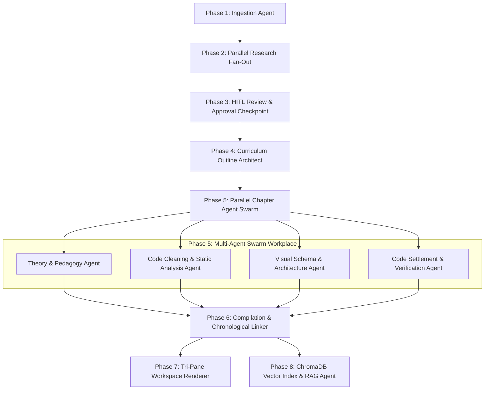

# 4 U By U • Interactive Educational Notes & Tri-Pane Study Workspace

> **"For You, By You"**  
> AI-Synthesized Educational Study Workspace for Technical Video Lectures & Masterclasses.  
> Sibling project to **R-Prep** (AI Resume Preparation Suite on Vercel).  
> Live Deployment: [4ubyu.vercel.app](https://4ubyu.vercel.app/)

---

## 🏛️ System Architecture Overview

4 U By U transforms long-form video lectures (YouTube, recorded webinars, technical courses) into an interactive, synchronized **3-segment study workspace**:

```text
┌───────────────────────────────────────────────┬─────────────────────────────────────┐
│                                               │ TOP-RIGHT PANE:                     │
│ LEFT PANE (Desktop 100vh / Mobile Full Page): │ YouTube Video Player Window         │
│                                               │ • Responsive 16:9 synchronized view │
│ Educational Notes & Handbook ("Instrument")   │ • YouTube IFrame API two-way sync   │
│ • Sticky Chapter Navigation & Topic Filter    ├─────────────────────────────────────┤
│ • Clickable Timestamp Badges [▶ 04:25]        │ HORIZONTAL SPLITTER (Drag Up/Down)  │
│ • Prism.js Syntax-Highlighted Code Blocks     ├─────────────────────────────────────┤
│ • Interactive Mermaid & SVG Diagrams          │ BOTTOM-RIGHT PANE:                  │
│ • Reading-Aware Viewport Auto-Seek Observer   │ Docked Contextual RAG Chatbot       │
│                                               │ • Real-time SSE token streaming     │
│                                               │ • Grounded 🔒 vs. Open ⚡ Toggle    │
│                                               │ • Clickable [▶ MM:SS] citations     │
├───────────────────────────────────────────────┴─────────────────────────────────────┤
│ VERTICAL SPLITTER (Desktop Drag Left/Right) / BOTTOM DOCK (Mobile Tab Switcher)     │
└─────────────────────────────────────────────────────────────────────────────────────┘
```

---

## 🤖 The Multi-Agent Swarm Architecture

The core of 4 U By U is an **8-Phase Multi-Agent Pipeline** powered by LangGraph, non-destructive merge reducers, and specialized autonomous agents working in sequential, parallel fan-out, and batched swarm configurations:



### Detailed Agent Roles & Pipeline Phases

#### 1. Phase 1: Video Ingestion & Audio Transcriber Agent (`phase1_ingestion.py`)
- Extracts video metadata (duration, title, author, description, chapter markers).
- Fetches exact verbatim subtitle transcripts using `transcriber.py`.
- Formats every sentence with strict integer-second time offsets (`timestamp_seconds` and `[MM:SS]`).

#### 2. Phase 2: Parallel Fan-Out Research Agent (`phase2_parallel.py`)
- Executes parallel fan-out analysis across 3 specialized tasks:
  1. **Description & Metadata Extraction**: Identifies mentioned GitHub repos, papers, and tech stacks.
  2. **Topic Gap Detection**: Compares spoken lecture content against official documentation to detect missing edge cases.
  3. **Visual Slide Extractor**: Locates key lecture frames and timestamps requiring architectural diagrams.

#### 3. Phase 3: Human-in-the-Loop (HITL) Checkpoint Review (`phase3_hitl.py`)
- Presents an interactive preview modal on the web interface allowing the user to:
  - Add, edit, or delete suggested chapter boundaries.
  - Set custom target topics and adjust pedagogical depth before LLM token generation begins.
- Acts as a LangGraph interruptible checkpoint ensuring zero token waste.

#### 4. Phase 4: Master Outline Curriculum Architect (`phase4_structure.py`)
- Analyzes the approved chapter list and produces a structured section hierarchy:
  - Definition of Core Mental Models
  - Implementation & Code Walkthroughs
  - Architectural Schematics & Data Flows
  - Pitfalls, Common Errors, and Production Gotchas

#### 5. Phase 5: Parallel Chapter Agent Swarm (`phase5_chapter_agents.py`)
Each section is dispatched concurrently to a dedicated sub-agent swarm:
- **Theory & Pedagogy Agent**: Synthesizes structured markdown explanations, mathematical formulations, analogies, and key takeaways strictly grounded in the instructor's audio.
- **Code Cleaning & Static Analysis Agent (`core/code_cleaning_agent.py`)**: Cleans spoken code, verifies imports, adds type annotations, formats comments, and applies domain-specific verification.
- **Visual Schema & Architecture Agent (`core/visual_architect.py`)**: Analyzes technical relationships to dynamically generate Mermaid.js sequence diagrams, flowchart SVGs, or Eraser.io cloud diagrams.
- **Code Settlement Agent (`core/code_settlement_agent.py`)**: Cross-references synthesized code blocks against video keyframes to ensure 100% syntactic and behavioral alignment.

#### 6. Phase 6: Compilation & Chronological Linker (`phase6_compilation.py`)
- Validates Markdown integrity, verifies that all code blocks have language tags (`python`, `sql`, `typescript`), and resolves cross-references.
- Converts raw timestamp strings into bidirectional YouTube seek triggers (`seekToVideo(seconds)`).

#### 7. Phase 7: Responsive Tri-Pane Workspace Renderer (`phase7_renderer.py`)
- Generates a standalone, dependency-free HTML handbook powered by:
  - **Desktop**: Dual-axis splitters (horizontal & vertical) with localStorage split persistence.
  - **Mobile (<= 960px)**: Fluid document-level native momentum scrolling, collapsible companion panes, and a fixed 60px bottom dock (`Notes`, `Video`, `Assistant`).

#### 8. Phase 8: Contextual RAG Chatbot Agent (`phase8_chatbot.py`)
- Indexes the compiled handbook into a local **ChromaDB vector store** using HuggingFace embeddings (`all-MiniLM-L6-v2`) and BM25 hybrid ranking.
- Features a **Dual-Mode Knowledge Toggle**:
  - **Grounded Mode (🔒)**: Strict extractive QA answering ONLY from the video transcript and handbook text with clickable timestamp citations (`[▶ 12:45]`).
  - **Open Mode (⚡)**: Broad reasoning utilizing external engineering knowledge, best practices, and code examples while maintaining lecture context.

---

## ⚡ LangGraph State Machine & Lossless Reducers (`states.py`)

To eliminate state destruction across parallel branches, `states.py` defines typed schemas and non-destructive merge reducers:

```python
class SectionState(TypedDict):
    section_id: str
    section_title: str
    timestamp_seconds: int
    transcript_slice: str
    
    # Parallel Sub-Agent Write Slots with Non-Destructive Reducers
    theory_block: Annotated[dict, merge_section_contents]
    visual_diagrams: Annotated[list, merge_list_reducer]
    code_blocks: Annotated[list, merge_list_reducer]
    key_points: Annotated[list, merge_list_reducer]
    examples: Annotated[list, merge_list_reducer]
    supplement_block: Annotated[dict, merge_section_contents]
```

---

## 🛡️ Zero-Cost Anti-Debit Guarantee & Model Router

4 U By U features an intelligent Model Router (`core/model_router.py`) with strict zero-cost safeguards:

| Provider | Supported Models | Tier | Cost |
|---|---|---|---|
| **Groq Cloud** | `openai/gpt-oss-120b`, `openai/gpt-oss-20b`, `qwen/qwen3.8-27b` | Free Tier (Sub-Second) | $0.00 |
| **Google AI Studio** | `gemini-2.0-flash`, `gemini-1.5-flash` | 100% Free Tier | $0.00 |
| **OpenRouter** | `meta-llama/llama-3.3-70b-instruct:free`, `google/gemini-2.0-flash-exp:free` | `:free` Tier Only | $0.00 |

- **Bring Your Own Key (BYOK)**: Public users supply their own free-tier API keys. Personal debit or credit cards are never attached.
- **Storage Circuit Breaker**: Prevents disk or cloud database overflow on free tiers.

---

## 📁 Project Structure

```text
4_u_by_u/
├── app.py                     # FastAPI web server & SSE chat streaming endpoints
├── main.py                    # Master CLI end-to-end multi-agent pipeline
├── config.py                  # Dual-mode settings & zero-cost guardrails
├── states.py                  # LangGraph TypedDict schemas & merge reducers
│
├── phase1_ingestion.py        # Video metadata & verbatim transcript fetch
├── phase2_parallel.py         # Parallel fan-out (metadata, labels, topic gaps)
├── phase3_hitl.py             # Human-in-the-Loop topic approval checkpoint
├── phase4_structure.py        # Master outline curriculum architect
├── phase5_chapter_agents.py   # Multi-agent swarm (Theory, Code, Visual, Settlement)
├── phase6_compilation.py      # Chapter compiler & chronological timestamp linker
├── phase7_renderer.py         # Responsive tri-pane workspace HTML generator
├── phase8_chatbot.py          # ChromaDB RAG vector store & streaming QA assistant
│
├── core/
│   ├── model_router.py        # Dynamic BYOK regex detector & LLM factory
│   ├── transcriber.py         # YouTube transcript & timestamp formatter
│   ├── visual_architect.py    # Mermaid.js & SVG architecture diagram generator
│   ├── code_cleaning_agent.py # Code linting, type annotation, & syntax verification
│   ├── code_settlement_agent.py # Keyframe-to-code alignment verification
│   ├── handbook_rag.py        # Hybrid vector & BM25 retrieval engine
│   └── library_manager.py     # output/library.json catalog manager
│
├── templates/
│   ├── index.html             # Landing page & study library dashboard
│   └── base_workspace.html    # Responsive 3-pane interactive workspace template
│
├── static/
│   ├── css/                   # landing.css, workspace_layout.css, theme_dark_academic.css
│   ├── js/                    # landing.js, workspace_splitter.js, yt_sync_controller.js, rag_chat_client.js
│   └── images/                # Brand logo & 3D metallic insignia
│
└── output/
    ├── library.json           # Catalog of generated study workspaces
    └── notes_*.html           # Standalone interactive study handbooks
```

---

## 🚀 Quickstart & Local Setup

### 1. Clone the Repository
```bash
git clone https://github.com/anikethana21/4ubyu.git
cd 4ubyu
```

### 2. Install Dependencies
```bash
pip install -r requirements.txt
```

### 3. Environment Configuration (Optional)
Create a `.env` file in the project root:
```env
APP_MODE=private
GROQ_API_KEY=your_free_groq_key_here
GEMINI_API_KEY=your_free_gemini_key_here
```
*(Leave blank to use the built-in zero-cost tier or paste free keys).*

### 4. Run the Web Application
```bash
python app.py
```
Open **[http://127.0.0.1:8000](http://127.0.0.1:8000)** in your browser!

---

## 🤝 Ecosystem
- **4 U By U (Notes Workspace)**: [4ubyu.vercel.app](https://4ubyu.vercel.app/)
- **R-Prep (AI Resume Preparation Suite)**: [r-prep.vercel.app](https://r-prep.vercel.app/)
- **Placements Guide (Masterclass Study Blueprints)**: [placements-guide.vercel.app](https://placements-guide.vercel.app/)
